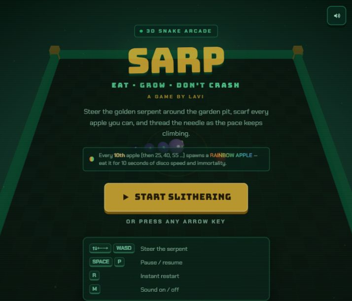
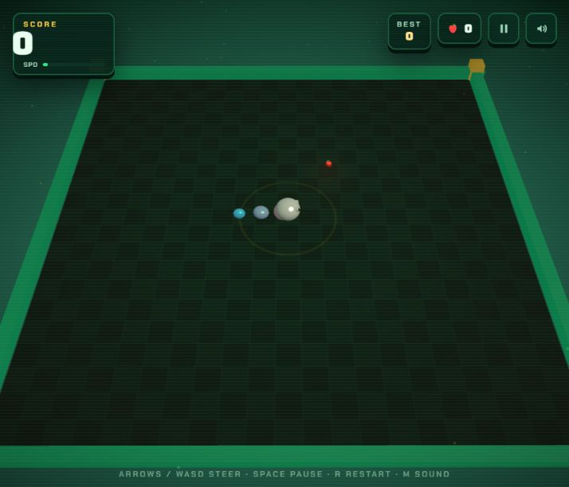
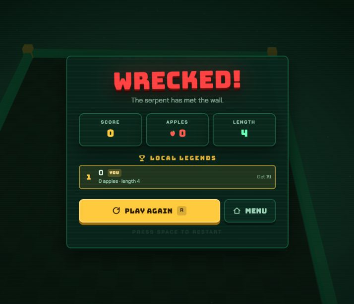
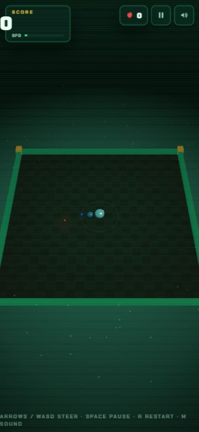

# Sarp

**A 3D browser game inspired by classic Snake.** Eat apples, steer through the arena, and keep going as the pace rises. The 10th apple, then every 15th after that, spawns a Rainbow Apple and a short burst of Rainbow Mode.

<p align="center">
  <a href="https://sarp3d.vercel.app/"><strong>▶ Play Sarp online</strong></a>
</p>

<p align="center">
  
</p>

## Screenshots

### Gameplay



### Game over



### Narrow screen



## How to play

Collect apples to grow and score. Avoid the arena walls and your own body. The speed increases over time, so plan turns ahead.

### Keyboard

| Keys | Action |
| --- | --- |
| Arrow keys or **W A S D** | Steer |
| **Space**, **P**, or **Esc** | Pause or resume |
| **R** | Restart |
| **M** | Toggle sound |
| **Q** | Return to the menu while paused |

On touch screens, swipe to steer or use the on-screen direction pad. Its center button pauses the game.

## Features

- A 3D snake arena with a 21 × 21 grid and an increasingly quick pace
- Classic apples, occasional Golden and Magnet Apples, and milestone Rainbow Apples
- Combos, Fever Mode, multiple snake skins, and changing weather effects
- Procedurally generated music and sound effects
- Achievements and a local top-five score table saved in your browser
- Optional global **all-time and weekly leaderboards** with guest profiles
- Top 10 world rankings plus your own world rank, even when you are outside the Top 10
- Dense ranking for tied scores, with the earlier achieved score listed first
- Weekly leaderboard resets every Monday at 00:00 UTC
- Server-side username moderation and score-submission checks
- Keyboard and touch controls

## Global leaderboard

Sarp now supports an optional worldwide leaderboard. The first time you start a run, choose a public username (3–16 characters; letters, numbers, and underscores). You can change it later from the main menu. Usernames do not need to be unique because each guest player has a separate, private guest ID.

The leaderboard has two views:

- **All-time** — each player's best submitted score.
- **This week** — each player's best score for the current UTC week, beginning Monday at 00:00 UTC.

Only a new personal-best run is submitted. Tied scores share the same rank; the earlier achieved score is shown first. The leaderboard displays the Top 10 and separately shows your own rank if you are outside the Top 10.

Global participation uses an anonymous guest session—no email, password, or social account is required. Your username is public; your guest ID is not displayed. Guest identity is stored in this browser, so clearing site data or switching devices loses access to that guest profile. There is no account recovery.

Local scores and achievements remain stored separately in your browser and continue to work if the online leaderboard is unavailable. If the service or your connection is down, Sarp displays **Leaderboard unavailable** and gameplay remains playable.

## Built with

React 19, TypeScript 5.9, Three.js 0.186, Tailwind CSS 4, and Vite 7. The Vite build uses `vite-plugin-singlefile` to bundle the browser game into a self-contained HTML file.

## Run locally

You’ll need Node.js 20.19+ (or 22.12+) and npm.

```bash
git clone https://github.com/hmmlavi/Sarp.git
cd Sarp
npm install
npm run dev
```

Open the local URL printed by Vite. To create and preview a production build:

```bash
npm run build
npm run preview
```

The build is written to `dist/` and can be served as a static site.

## Project layout

```text
src/
  App.tsx          Game state, input, and screen flow
  ui.tsx           Menus, HUD, and overlays
  index.css        App styling
  game/            Three.js engine, effects, audio, scores, and achievements
  online/          Guest sessions and global leaderboard UI/API client
  utils/           Shared utilities
docs/
  screenshots/     Captures of the deployed game
  social-preview.png  Repository social preview image
```

## Credits

Sarp is created by [Lavi](https://github.com/hmmlavi).

## License

No license is currently included in this repository. Check with the author before redistributing or reusing the project.
