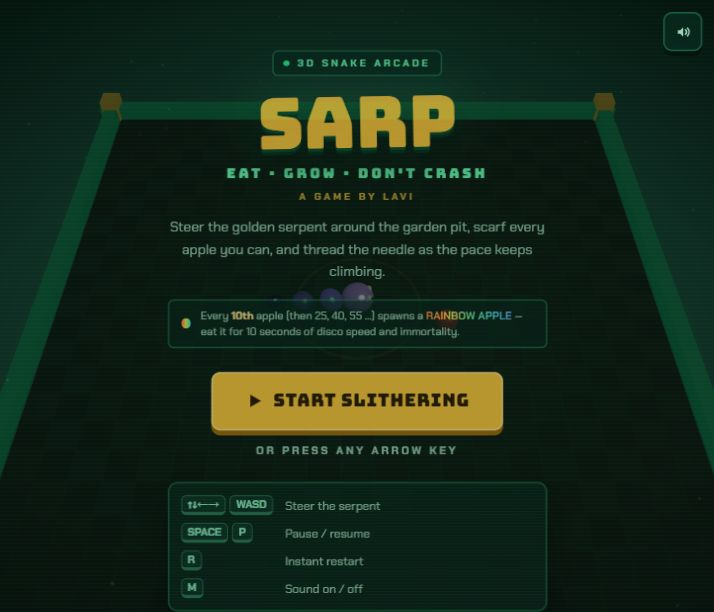
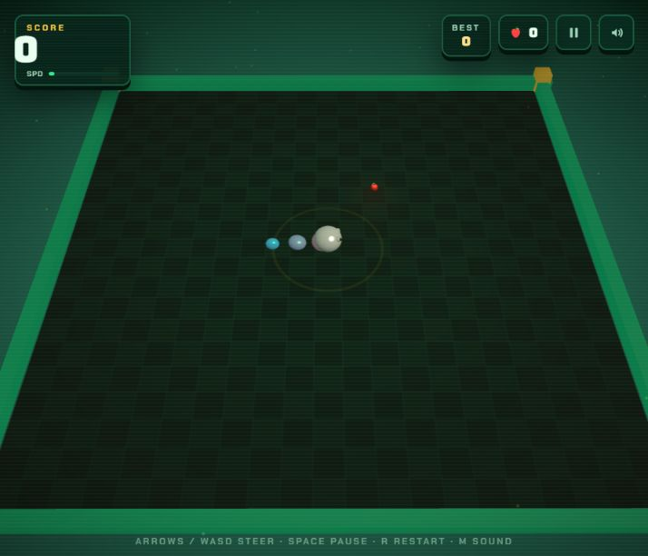
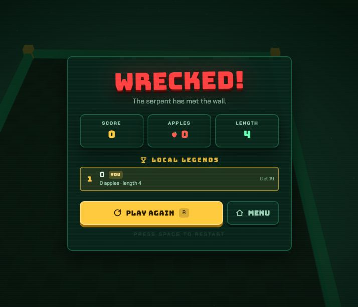
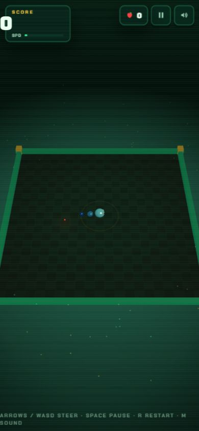

# 🐍 Sarp

### A fast-paced 3D Snake game with a little more personality.

Eat. Grow. Chase the next high score.

[**▶ Play Sarp**](https://sarp-kappa.vercel.app/) · [Report a bug](https://github.com/hmmlavi/Sarp/issues) · [View source](https://github.com/hmmlavi/Sarp)

---

## 🎮 What is Sarp?

Sarp is a browser-based 3D take on the classic Snake game. Guide your snake around a compact arena, collect apples, build combos, and survive as the pace gets faster. Special apples, changing weather, sound, skins, achievements, and local high scores make every run a little different.

No installation or account is needed to play. Open the game and start a run.

  

## ✨ Highlights

- **3D arena** — a 21 × 21 grid with smooth movement and an increasingly quick pace.
- **Special apples** — Classic, Golden, Magnet, and milestone Rainbow Apples.
- **Fever & combos** — keep a streak going and push your score higher.
- **Personal style** — multiple snake skins and changing weather effects.
- **Sound** — procedurally generated music and sound effects, with an in-game toggle.
- **Achievements** — milestones to chase and a local top-five leaderboard.
- **Touch-friendly** — swipe controls and an on-screen direction pad for mobile.

## 📸 Screenshots

| Main menu | Gameplay |
|:---:|:---:|
|  |  |

| Game over | Mobile gameplay |
|:---:|:---:|
|  |  |

## 🕹️ How to play

1. Start a run and steer around the arena.
2. Collect apples to grow and increase your score.
3. Avoid the walls and your own body.
4. Watch your speed: it increases as the run continues.
5. Hit milestones, discover special apples, and beat your best score.

### Keyboard controls

| Key | Action |
|:---|:---|
| ↑ ↓ ← → or W A S D | Steer |
| Space / P / Esc | Pause or resume |
| R | Restart |
| M | Toggle sound |
| Q | Return to menu while paused |

**Mobile:** Swipe in the direction you want to move, or use the on-screen direction pad. The center button pauses the game.

## 💾 Local progress

High scores and achievements are saved in your browser. Sarp runs as a single-player game and does not require an account, Supabase, or an online service.

## 🧰 Run locally

### Requirements

- Node.js 20.19+ or 22.12+
- npm

### Setup

~~~bash
git clone https://github.com/hmmlavi/Sarp.git
cd Sarp
npm install
npm run dev
~~~

Open the local address printed by Vite.

### Production build

~~~bash
npm run typecheck
npm run build
npm run preview
~~~

The production output is generated in the dist/ directory and can be hosted as a static site.

## 🧱 Tech stack

| Technology | Role |
|:---|:---|
| React 19 | UI and application state |
| TypeScript 5.9 | Type-safe application code |
| Three.js 0.186 | 3D game rendering |
| Tailwind CSS 4 | Styling |
| Vite 7 | Development server and production build |
| vite-plugin-singlefile | Bundles the game into a self-contained HTML file |

## 🗂️ Project structure

~~~text
src/
├── App.tsx          # Game state, input, and screen flow
├── ui.tsx           # Menus, HUD, and overlays
├── index.css        # Global styling
├── game/            # Three.js engine, effects, audio, scores, achievements
└── utils/           # Shared utilities

docs/
├── screenshots/     # Game screenshots
├── RELEASING.md     # Versioning and GitHub release process
└── social-preview.png
~~~

## 🛠️ Contributing

Found a bug or have an idea? Open an [issue](https://github.com/hmmlavi/Sarp/issues) with steps to reproduce it, or submit a pull request.

For meaningful changes:
1. Keep gameplay and local progress working without network services.
2. Avoid breaking local scores and achievements.
3. Run `npm run typecheck` and `npm run build`.
4. Include screenshots or a short recording for visual changes.

## 📋 Version history

See the [changelog](CHANGELOG.md) for release notes and [release instructions](docs/RELEASING.md) for publishing a new version.

## 👤 Created by

**Lavi** · [GitHub @hmmlavi](https://github.com/hmmlavi)

---

**Thanks for checking out Sarp. Have fun, and beat your best!**

[▶ Play now](https://sarp-kappa.vercel.app/)

