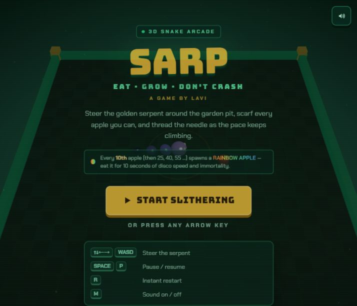
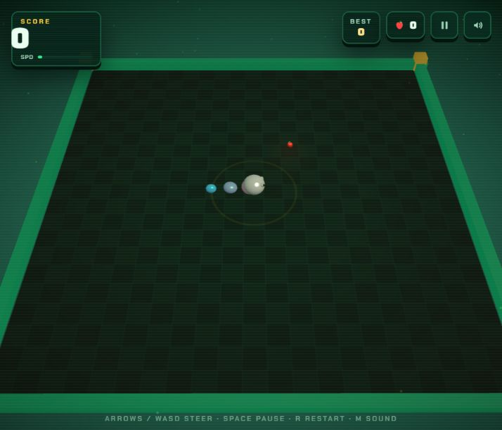
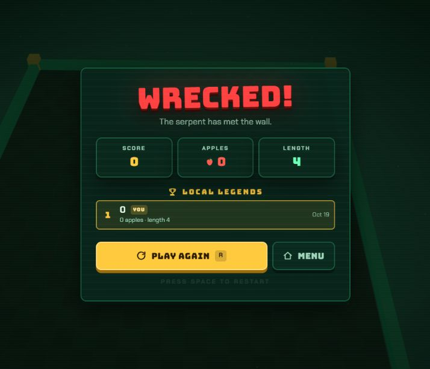
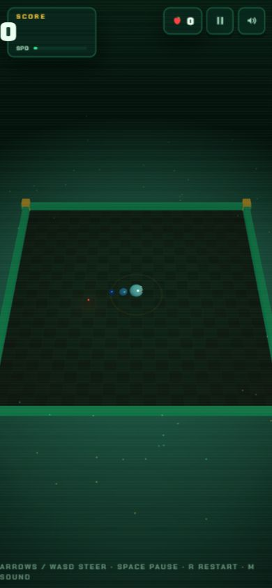

# Sarp

**A 3D browser game inspired by classic Snake.** Eat apples, steer through the arena, and keep going as the pace rises. The 10th apple, then every 15th after that, spawns a Rainbow Apple and a short burst of Rainbow Mode.

<p align="center">
  <a href="https://sarp3d.vercel.app/"><strong>▶ Play Sarp online</strong></a>
</p>

<p align="center">
  
</p>

## Screenshots

### Gameplay



### Game over



### Narrow screen



## How to play

Collect apples to grow and score. Avoid the arena walls and your own body. The speed increases over time, so plan turns ahead.

### Keyboard

| Keys | Action |
| --- | --- |
| Arrow keys or **W A S D** | Steer |
| **Space**, **P**, or **Esc** | Pause or resume |
| **R** | Restart |
| **M** | Toggle sound |
| **Q** | Return to the menu while paused |

On touch screens, swipe to steer or use the on-screen direction pad. Its center button pauses the game.

## Features

- A 3D snake arena with a 21 × 21 grid and an increasingly quick pace
- Classic apples, occasional Golden and Magnet Apples, and milestone Rainbow Apples
- Combos, Fever Mode, multiple snake skins, and changing weather effects
- Procedurally generated music and sound effects
- Achievements and a local top-five score table saved in your browser
- Keyboard and touch controls

Scores, achievements, and the sound preference are stored locally in your browser. Sarp does not require an account.

## Built with

React 19, TypeScript 5.9, Three.js 0.186, Tailwind CSS 4, and Vite 7. The Vite build uses `vite-plugin-singlefile` to bundle the browser game into a self-contained HTML file.

## Run locally

You’ll need Node.js 20.19+ (or 22.12+) and npm.

```bash
git clone https://github.com/hmmlavi/Sarp.git
cd Sarp
npm install
npm run dev
```

Open the local URL printed by Vite. To create and preview a production build:

```bash
npm run build
npm run preview
```

The build is written to `dist/` and can be served as a static site.

## Project layout

```text
src/
  App.tsx          Game state, input, and screen flow
  ui.tsx           Menus, HUD, and overlays
  index.css        App styling
  game/            Three.js engine, effects, audio, scores, and achievements
  utils/           Shared utilities
docs/
  screenshots/     Captures of the deployed game
  social-preview.png  Repository social preview image
```

## Credits

Sarp is created by [Lavi](https://github.com/hmmlavi).

## License

No license is currently included in this repository. Check with the author before redistributing or reusing the project.
